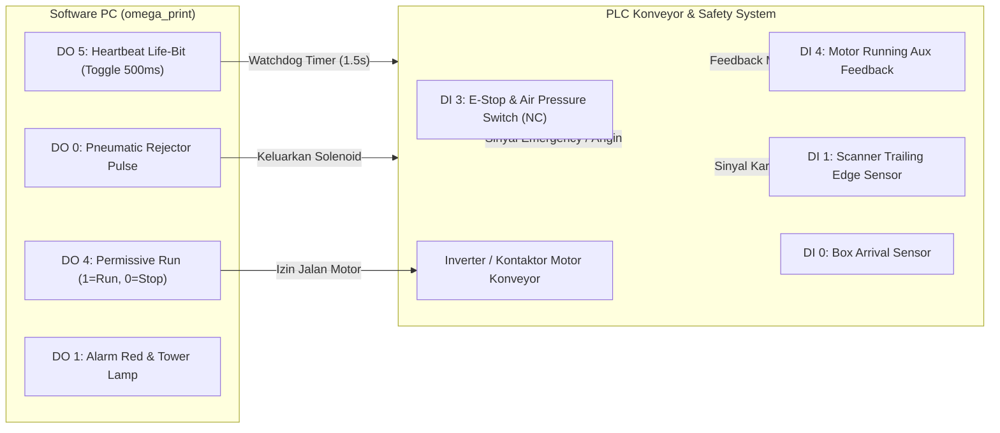

# Panduan & Dokumentasi Integrasi Modbus I/O (PC & PLC Konveyor)
**Aplikasi:** Omega Print & QC System (`omega_print`)  
**Versi Sistem:** v4.0 (Industrial Interlock & Closed-Loop Safety)  
**Dokumen:** Spesifikasi Teknis Pemetaan Sinyal, Safety Interlock, dan Watchdog PLC

---

## 1. Ringkasan Arsitektur Sistem

Sistem `omega_print` terhubung secara langsung dengan PLC (*Programmable Logic Controller*) pengendali motor konveyor dan aktuator penendang (*pneumatic rejector*) menggunakan protokol **Modbus TCP** (Ethernet port 502) atau **Modbus RTU** (Serial RS-485 / RS-232).

Integrasi ini menerapkan prinsip **Closed-Loop Two-Way Safety Interlock**:
1. **Software Error $\rightarrow$ Konveyor Otomatis STOP:**  
   Jika terjadi gangguan pada software (kabel scanner/printer lepas, 3x NG beruntun, tinta habis, aplikasi crash), sinyal izin jalan konveyor (*Permissive Run*) seketika diputus sehingga PLC menghentikan konveyor secara otomatis.
2. **Hardware Emergency $\rightarrow$ Software Otomatis PAUSE:**  
   Jika terjadi kondisi darurat di lapangan (tombol Emergency Stop ditekan, tekanan angin drop, atau thermal overload motor trip), software seketika masuk ke status **PAUSED** dan menahan seluruh pengiriman data ke printer.



---

## 2. Pemetaan Memori Register Modbus (I/O Map)

> File spreadsheet Excel resmi siap pakai untuk komisioning PLC dapat diunduh di direktori project:  
> 📄 **[`TABEL_ALOKASI_IO_PLC_OMEGA.xlsx`](file:///d:/Hasya/omega-print/omega_print/TABEL_ALOKASI_IO_PLC_OMEGA.xlsx)**

### A. Modbus TCP: Digital Output (DO / Coils — Kendali PC ke PLC)
Fungsi Modbus: `01 (Read Coils)` & `05 / 15 (Write Single/Multiple Coils)`

| Bit | Alamat (0-Based) | Alamat Standar PLC (1-Based) | Register Tampung PLC | Nama Sinyal | Tipe | Deskripsi & Logika Operasi |
| :---: | :---: | :---: | :---: | :--- | :---: | :--- |
| **DO 0** | `0` | `00001` | **M100** | **Pneumatic Pusher** | Pulse | Menggerakkan silinder penendang kardus NG (Pulsa aktif default: **0.5s / 500ms**). |
| **DO 1** | `1` | `00002` | **M101** | **Tower Lamp MERAH / Buzzer** | Level / Pulse | Aktif berkedip/bunyi saat terdeteksi hasil NG atau terjadi alarm kritis pada sistem. |
| **DO 2** | `2` | `00003` | **M102** | **Tower Lamp KUNING** | Level | Indikator mesin dalam status siaga (*Standby*) atau sedang dijeda (*PAUSED*). |
| **DO 3** | `3` | `00004` | **M103** | **Tower Lamp HIJAU** | Level | Indikator proses produksi berjalan normal (*RUNNING*) dan QC kardus OK. |
| **DO 4** | `4` | `00005` | **M104** | **Conveyor Permissive Run** | Level | **INTERLOCK UTAMA.** Bernilai `1` jika sistem sehat & batch berjalan. Bernilai `0` jika ada error $\rightarrow$ **PLC WAJIB mematikan motor konveyor**. |
| **DO 5** | `5` | `00006` | **M105** | **Heartbeat Watchdog (Life-Bit)** | Toggle | Berkedip bergantian `0` $\leftrightarrow$ `1` setiap **500 ms**. Jika berhenti berkedip $> 1.5$ detik $\rightarrow$ **PLC mematikan konveyor**. |

---

### B. Modbus TCP: Digital Input (DI / Discrete Inputs — Sensor PLC ke PC)
Fungsi Modbus: `02 (Read Discrete Inputs)`

| Bit | Alamat (0-Based) | Alamat Standar PLC (1-Based) | Sumber Register PLC | Nama Sinyal | Tipe | Logika Lapangan & Respon Software |
| :---: | :---: | :---: | :---: | :--- | :---: | :--- |
| **DI 0** | `0` | `10001` | **X0 / M0** | **Sensor Head Print** | Pulse | Mendeteksi kardus tiba sebelum memasuki area print head printer. |
| **DI 1** | `1` | `10002` | **X1 / M1** | **Sensor Scanner** | Falling Edge | **Trailing Edge Sensor.** Saat ekor kardus lepas (`1` $\rightarrow$ `0`):<br>1. Memeriksa hasil scan Keyence (Jika kosong $\rightarrow$ Auto-NG No Read).<br>2. Menghitung tunda gerak (*pusher delay*) menuju silinder rejector. |
| **DI 2** | `2` | `10003` | **X2 / M2** | **Sensor Pusher** | Pulse | Mendeteksi kardus tepat di bibir silinder penendang rejector. |
| **DI 3** | `3` | `10004` | **X3 / M3** | **Safety Interlock & Air OK** | Level | **Sirkuit Keselamatan (Normally High / 24V).**<br>Jika tombol E-Stop ditekan atau tekanan angin drop $< 4.5$ Bar $\rightarrow$ bit menjadi `0` $\rightarrow$ **Software otomatis PAUSE batch & mematikan DO 4**. |
| **DI 4** | `4` | `10005` | **X4 / M4** | **Conveyor Running Feedback** | Level | Auxiliary contact dari inverter/kontaktor motor konveyor (`1` = Motor berputar fisik). Jika `0` saat status RUNNING $\rightarrow$ **Software Auto-PAUSE (Motor Trip)**. |
| **DI 5** | `5` | `10006` | **X12 / M5** | **Mode Bypass / Manual Panel** | Level | **Selector Switch Fisik di Panel.**<br>`1` = Mode Bypass aktif (Interlock software PC dilepas untuk manual/flushing).<br>`0` = Mode Auto normal (Interlock software PC aktif penuh). |

---

### C. Terminal I/O Fisik PLC (Wiring Input X & Output Y)

#### 1. Input Fisik (Terminal X — 24V DC Sinking / Sourcing)
| Terminal PLC | Nama Komponen Fisik | Tipe Kontak | Kategori | Keterangan Pengkabelan |
| :---: | :--- | :---: | :---: | :--- |
| **X0** | Sensor Photo-Electric Print Head | NO (NPN/PNP) | Sensor Mesin | Mendeteksi kardus tepat sebelum area head print |
| **X1** | Sensor Photo-Electric Dual Scanner | NO (NPN/PNP) | Sensor Mesin | Mendeteksi kardus tepat di bawah scanner Keyence |
| **X2** | Reed Switch Silinder Pusher (Home) | NO (Magnetic) | Sensor Mesin | Memastikan silinder mundur penuh sebelum kardus berikutnya lewat |
| **X3** | Pressure Switch Angin Kompresor | NO (Tutup $\ge$ 4.5 Bar) | Keselamatan | Interlock tekanan angin pneumatik pusher |
| **X4** | Tombol Emergency Stop Meja Konveyor | NC (Jamur Merah) | Keselamatan | Saklar darurat fisik di meja conveyor operator |
| **X5** | Tombol Emergency Stop Pintu Panel | NC (Jamur Merah) | Keselamatan | Saklar darurat fisik di pintu panel kontrol utama |
| **X6** | Push Button START Konveyor Lokal | NO (Hijau Flush) | Tombol Panel | Menjalankan konveyor manual dari panel |
| **X7** | Push Button STOP Konveyor Lokal | NC (Merah Extended)| Tombol Panel | Menghentikan konveyor dari panel |
| **X10**| Push Button RESET Alarm / Fault | NO (Biru/Kuning) | Tombol Panel | Mereset fault inverter VSD dan alarm sistem |
| **X11**| Push Button JOG Manual Konveyor | NO (Hitam Flush) | Tombol Panel | Memutar konveyor perlahan untuk maintenance/setup |
| **X12**| Selector Switch AUTO / MANUAL | Selector 2-Posisi | Tombol Panel | Memilih kendali via PC (Auto) atau via Pushbutton (Manual)|
| **X13**| Push Button Test Manual Pusher | NO (Putih Flush) | Tombol Panel | Uji coba gerak silinder pendorong tanpa PC |

#### 2. Output Fisik (Terminal Y — Transistor / Relay 24V DC)
| Terminal PLC | Nama Komponen Fisik | Tipe Beban | Kategori | Keterangan Aktuator |
| :---: | :--- | :---: | :---: | :--- |
| **Y0** | Solenoid Valve Silinder Pusher | Solenoid 24V DC | Aktuator | Mendorong kardus NG keluar konveyor (Pulsa 0.5s) |
| **Y1** | Tower Lamp MERAH & Buzzer | Lampu + Sirine | Indikator | Alarm NG / Disconnect / Cascade 3x NG |
| **Y2** | Tower Lamp KUNING | Lampu 24V DC | Indikator | Status Jeda / Siaga (PAUSED / STANDBY) |
| **Y3** | Tower Lamp HIJAU | Lampu 24V DC | Indikator | Mesin Normal Cetak & QC Berjalan Lancar |
| **Y4** | Main Safety Contactor Daya Motor VSD | Kontaktor 24V DC | Tenaga | Memutus suplai daya 3-phase ke motor saat E-Stop |
| **Y5** | Lampu Indikator Tombol START Panel | LED 24V DC | Indikator | Menyala saat konveyor dalam posisi izin jalan |
| **Y6** | Klakson Pre-Start Warning Horn | Sirine 24V DC | Keselamatan | Bunyi 2 detik sebelum konveyor berputar |
| **Y7** | Auxiliary Spare Output | Dry Contact Relay | Spare | Cadangan untuk integrasi mesin hulu/hilir |

---

### D. Modbus RTU Serial: PLC $\leftrightarrow$ VSD Inverter (RS-485)
* **Kabel:** 2-Wire Twisted Pair berpelindung (Terminal `D+` / `D-` atau `RS485+` / `RS485-`).
* **Baudrate:** 9600 / 19200 bps, Parity: Even/None, Data: 8 bit, Stop: 1 bit, Slave ID: `1`.

| Item VSD | Alamat Register (Hex) | Alamat Standar (Desimal) | Fungsi Modbus | Arah Data | Nilai & Definisi Bit |
| :--- | :---: | :---: | :---: | :---: | :--- |
| **Control Word (Command)** | `2000H` | `48193` (8192) | `06 (Write)` | PLC $\rightarrow$ VSD | `0001H` = Run Forward<br>`0000H` = Decel Stop<br>`0003H` = Coast E-Stop<br>`0008H` = Fault Reset |
| **Target Frekuensi (Hz)** | `2001H` | `48194` (8193) | `06 (Write)` | PLC $\rightarrow$ VSD | `0` – `5000` (Satuan 0.01 Hz)<br>*Contoh: `3500` = 35.00 Hz, `5000` = 50.00 Hz* |
| **Status Word (Feedback)** | `2100H` | `48449` (8448) | `03 (Read)` | VSD $\rightarrow$ PLC | **Bit 0:** Running (1 = Jalan $\rightarrow$ Relay ke `DI 4` PC)<br>**Bit 2:** Inverter Trip (1 = Fault) |
| **Output Frekuensi Aktual** | `2101H` | `48450` (8449) | `03 (Read)` | VSD $\rightarrow$ PLC | Kecepatan aktual putaran motor dalam 0.01 Hz |
| **Output Arus Motor (A)** | `2102H` | `48451` (8450) | `03 (Read)` | VSD $\rightarrow$ PLC | Beban arus aktual motor dalam 0.1 Ampere |

---

### E. Alokasi Memori Internal PLC (Relay M, Timer T, Register D)
| Simbol PLC | Alamat | Nama Variabel | Tipe Data | Fungsi dalam Ladder PLC |
| :---: | :---: | :--- | :---: | :--- |
| **M** | `M100 - M105` | Buffer Modbus TCP dari PC | Bit (Coil) | Menampung `DO 0 - DO 5` yang dikirim software PC |
| **M** | `M0 - M4` | Buffer Modbus TCP ke PC | Bit (Input) | Menampung `DI 0 - DI 4` yang dibaca software PC |
| **M** | `M200` | `PC_COMM_FAULT` | Internal Flag | Aktif jika pulsa Heartbeat PC (`M105`) berhenti $> 1.5$ detik |
| **M** | `M201` | `VSD_COMM_FAULT` | Internal Flag | Aktif jika komunikasi serial RS-485 ke VSD gagal 3x berturut-turut |
| **M** | `M202` | `SAFETY_CIRCUIT_OK` | Internal Flag | Sirkuit E-Stop Meja, E-Stop Panel, dan Angin Kompresor aman |
| **M** | `M203` | `CONVEYOR_RUN_REQ` | Internal Flag | Permintaan konveyor jalan (Start aktif + `M104` Permissive aktif) |
| **T** | `T0` | Timer Watchdog PC | TON (1.5s) | Mereset setiap ada transisi pulsa `M105` (`0` $\leftrightarrow$ `1`). Output = `M200` |
| **T** | `T1` | Timer Pre-Start Horn | TON (2.0s) | Sirine klakson berbunyi 2 detik sebelum inverter konveyor berputar |
| **T** | `T2` | Timer Silinder Pusher | TON (0.5s) | Durasi silinder pendorong maju untuk menendang kardus NG |
| **T** | `T3` | Timer Pusher Travel Delay | TON (Variabel)| Tunda waktu tempuh kardus dari sensor scanner ke bibir pusher |
| **D** | `D100` | `Setpoint_Frekuensi_VSD` | Register (16-bit) | Menyimpan target kecepatan konveyor (misal: `K3500` = 35.00 Hz) |
| **D** | `D101` | `Aktual_Frekuensi_VSD` | Register (16-bit) | Menyimpan bacaan frekuensi aktual motor dari register `2101H` VSD |
| **D** | `D102` | `Aktual_Arus_VSD` | Register (16-bit) | Menyimpan arus beban motor dari register `2102H` VSD |

---

## 3. Matriks Skenario & Penanganan Kegagalan (Fail-Safe Matrix)

| Kejadian / Insiden | Deteksi Awal | Respon Software PC | Aksi Hardware PLC / Mesin |
| :--- | :--- | :--- | :--- |
| **Kabel LAN Scanner / Printer Lepas** | Thread Watchdog PC mendeteksi socket terputus | Muncul popup alarm, batch otomatis di-`PAUSE`, set `DO 4 = 0` | Inverter konveyor deselerasi (*ramp down*) hingga berhenti total. Kardus tidak terbuang sia-sia. |
| **3x Berturut-turut NG (Cascade NG)** | Counter QC mendeteksi 3x mismatch beruntun | Batch di-`PAUSE`, set status `ALARM`, set `DO 4 = 0`, bunyi sirene `DO 1 = 1` | Konveyor berhenti, line buzzer berbunyi, operator wajib memeriksa sinkronisasi kardus. |
| **Tekanan Angin Drop (< 4.5 Bar)** | Pressure switch membuka $\rightarrow$ PLC kirim `DI 3 = 0` | Deteksi `DI 3 == False`, batch seketika di-`PAUSE`, set `DO 4 = 0` | Konveyor berhenti. Menghindari kardus NG meluncur tanpa bisa ditendang silinder pneumatik. |
| **Tombol Emergency Stop Ditekan** | Safety relay membuka $\rightarrow$ Daya motor putus fisik | Deteksi `DI 3 == False`, set status `PAUSED`, tahan antrean cetak | Motor mati instan. Antrean di memori software tetap utuh sesuai urutan fisik kardus. |
| **Inverter Motor Konveyor Trip (Overload)** | Kontak Aux VFD membuka $\rightarrow$ `DI 4 = 0` | Deteksi `DI 4 == False` setelah izin jalan aktif, batch di-`PAUSE` | PLC mengunci sirkuit motor hingga tombol reset alarm ditekan. |
| **Komputer / Aplikasi PC Hang Total** | Heartbeat `DO 5` berhenti berkedip | *(Software tidak aktif)* | Timer Watchdog PLC (1.5s) kedaluwarsa $\rightarrow$ PLC mematikan kontaktor motor konveyor secara mandiri. |

---

## 4. Panduan Pemrograman Ladder Logic PLC

Berikut adalah contoh implementasi logika pada PLC (Siemens / Omron / Delta / Schneider / Mitsubishi):

### Rung 1: Watchdog Heartbeat PC (Life-Bit Detector)
```text
  DO 5 (Heartbeat PC)            +---------+
--------| P |--------------------| TON     |
                                 | IN      |
                                 | PT:1.5s |
                                 | Q: Fault|----+----( M100: PC_COMM_FAULT )
                                 +---------+    |
  DO 5 (Heartbeat PC)            +---------+    |
--------| N |--------------------| TON     |----+
                                 | IN      |
                                 | PT:1.5s |
                                 | Q: Fault|
                                 +---------+
```
*(Timer mereset setiap kali ada perubahan transisi `0` $\rightarrow$ `1` atau `1` $\rightarrow$ `0`. Jika tidak ada pulsa selama 1.5 detik, flag `PC_COMM_FAULT` aktif).*

### Rung 2: Kendali Motor Konveyor dengan Interlock Permissive Run
```text
  PB_START      PC_PERMISSIVE   PC_COMM_FAULT   E_STOP_OK       MOTOR_RUN
----| |----+--------| |--------------|/|------------| |------------( Y0 )
           |
  MOTOR_RUN|
----| |----+
```
* **Keterangan:** Motor konveyor (`Y0`) **TIDAK BISA JALAN** kecuali sinyal `PC_PERMISSIVE` (`DO 4`) bernilai `1` dan tidak ada fault komunikasi (`PC_COMM_FAULT = 0`).

---

## 5. Spesifikasi Elektrikal & Pengkabelan

1. **Level Tegangan:** Seluruh I/O digital menggunakan tegangan standar industri **24V DC**.
2. **Polaritas Input (DI):** 
   * Tipe NPN (Sinking) atau PNP (Sourcing) sesuai modul I/O.
   * Logika software mengasumsikan **Active HIGH** (`1` = sensor aktif / kondisi normal).
3. **Safety Circuit (DI 3):**
   * Hubungkan kontak bantu relai keselamatan (*Safety Relay*) dan *Pressure Switch* pneumatik secara **Seri (Normally Closed - NC)**.
   * Ketika kabel putus, switch lepas, atau tombol E-Stop ditekan, tegangan 24V terputus sehingga input PLC membaca `0` (*Fail-Safe by Design*).
4. **Koneksi Jaringan:**
   * Gunakan kabel LAN Cat6 berpelindung (*Shielded Twisted Pair - STP*) untuk lingkungan pabrik dengan gangguan elektromagnetik (VFD/Motor).
   * Alokasikan IP statis untuk PC (`192.168.100.50`), PLC (`192.168.100.10`), dan Scanner Keyence (`192.168.100.100 & 101`).

---

## 6. Prosedur Uji Komisioning di Lantai Produksi

Lakukan verifikasi berikut sebelum memulai produksi massal:

1. **Uji Coba Manual Tombol Pusher & Alarm:**
   * Buka tab **Konektivitas** di aplikasi `omega_print`.
   * Klik tombol **Uji Pusher (DO 0)**: Pastikan silinder pneumatik menendang maju selama 0.5 detik lalu kembali ke posisi semula.
   * Klik tombol **Uji Lampu Alarm (DO 1)**: Pastikan tower lamp merah menyala dan buzzer berbunyi.
2. **Uji Coba Interlock Emergency Stop:**
   * Jalankan batch cetak simulasi / nyata.
   * Tekan tombol Emergency Stop fisik di konveyor:
     * Motor konveyor harus berhenti seketika.
     * Software pada PC harus langsung berubah status menjadi **PAUSED**.
     * Kotak LED `[I3] 10004` di tab Konektivitas berubah dari **Hijau** menjadi **Abu-abu**.
3. **Uji Coba Disconnect Hardware (Simulasi Kabel Putus):**
   * Saat batch sedang berjalan, cabut kabel LAN scanner Keyence.
   * Popup alarm merah harus langsung muncul di tengah layar monitor PC.
   * Sinyal `DO 4` harus seketika drop ke `0`, dan PLC harus segera menghentikan motor konveyor.
4. **Uji Coba Pulsa Heartbeat:**
   * Pantau LED output `DO 5` pada modul PLC: lampu harus berkedip teratur dengan ritme 1 kali per detik (500ms ON / 500ms OFF).

