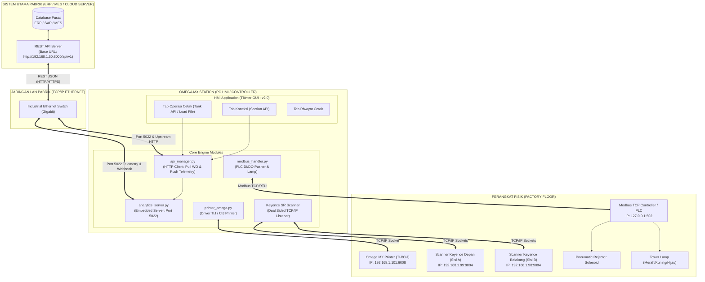
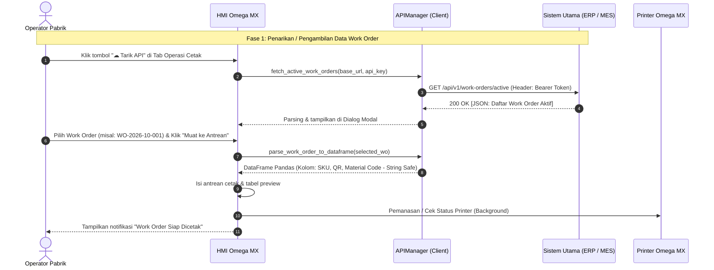
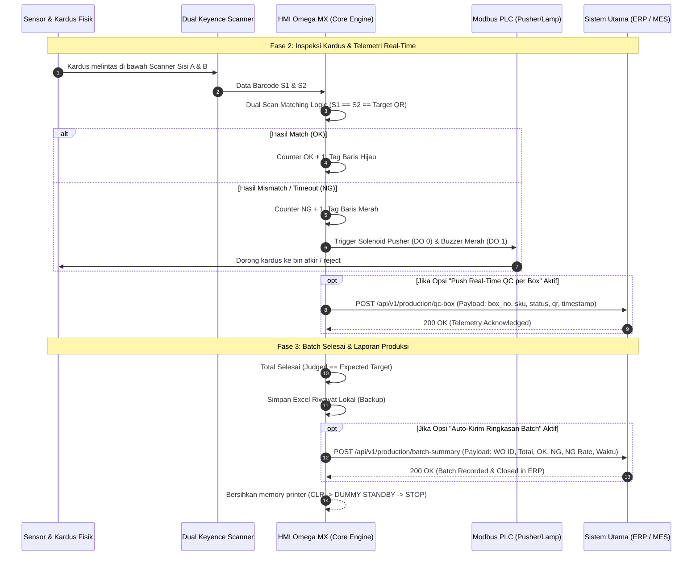

# ARSITEKTUR & SKEMA INTEGRASI REST API SISTEM UTAMA (v2.0)
## OMEGA MX - INDUSTRIAL BATCH PRINTING & DUAL-QC SYSTEM
*Dokumen Spesifikasi Teknis, Alur Data Dua Arah (Bi-Directional), dan Panduan Integrasi Pabrik*

---

## 1. Latar Belakang & Transformasi Sistem (v1.0 vs v2.0)

Pada versi sebelumnya (**v1.0**), sistem Omega MX mengandalkan pemuatan file secara manual menggunakan file spreadsheet (Excel `.xlsx` / `.csv`). Walaupun metode ini fungsional, terdapat beberapa keterbatasan operasional di lini manufaktur:
- Ketergantungan pada operator untuk memindahkan file fisik via flashdisk / network shared folder.
- Risiko human error (salah memilih file revisi lama atau data SKU yang belum di-release oleh bagian PPIC / QC).
- Data hasil inspeksi dan produksi (OK, NG, cycle time) tersimpan secara lokal dan baru dilaporkan ke manajemen secara periodik manual.

Pada versi baru (**v2.0 API Ready**), sistem ditingkatkan menjadi **Terintegrasi Penuh (Fully Integrated)** dengan **Sistem Utama Pabrik (ERP / MES / Core Server)** melalui **RESTful API Dua Arah (Bi-Directional Communication)**:
1. **Inbound (Sistem Utama ➔ Omega MX):** Mesin dapat menarik penugasan produksi (*Work Order / SPK*) secara real-time langsung dari database server, atau Sistem Utama dapat mendorong (*push*) SPK baru ke mesin.
2. **Outbound (Omega MX ➔ Sistem Utama):** Mesin secara otomatis mengirimkan ringkasan batch produksi (*Batch Summary*) saat pekerjaan selesai, serta telemetri real-time hasil inspeksi QC per box (*OK/NG status & barcode serial*).
3. **Graceful Fallback:** Tombol `Load File` Excel tetap dipertahankan 100% sebagai jalur darurat (*fail-safe*) jika jaringan LAN pabrik atau server Sistem Utama sedang mengalami gangguan teknis (*offline*).

---

## 2. Gambaran Skema Arsitektur (System Architecture)



---

## 3. Diagram Alur Data Dua Arah (Sequence Flow)

### 3.1. Skenario Inbound: Penarikan Work Order dari Sistem Utama
Operator memilih Work Order dari sistem ERP atau server pusat mengirimkan jadwal batch ke mesin:



### 3.2. Skenario Outbound: Telemetri Inspeksi Real-Time & Laporan Akhir Batch



---

## 4. Spesifikasi Kontrak REST API

Semua komunikasi data menggunakan format standar **JSON** dengan encoding **UTF-8**. Semua nilai barcode dan kode material diperlakukan sebagai **string murni** untuk menjamin tidak hilangnya *leading zeros* (contoh: `"00029348"` tidak akan terpotong menjadi `29348`).

### 4.1. Endpoint Inbound (Sistem Utama)

#### `GET /api/v1/work-orders/active`
Dipanggil oleh Omega MX untuk mengambil daftar perintah kerja (*Work Order*) yang berstatus aktif atau siap diproduksi.

- **Request Headers:**
  ```http
  Authorization: Bearer <API_KEY_OR_TOKEN>
  Accept: application/json
  ```
- **Response Format (200 OK):**
  ```json
  {
    "status": "success",
    "total": 2,
    "data": [
      {
        "work_order_id": "WO-2026-10-001",
        "sku_code": "SKU-9921",
        "sku_name": "Ultra Packaging Box 250ml",
        "material_code": "MAT-KARTON-01",
        "batch_no": "B2610A",
        "target_qty": 500,
        "priority": "HIGH",
        "status": "READY",
        "notes": "Pesanan Ekspor Line 3",
        "items": [
          { "No": 1, "SKU": "SKU-9921", "QR": "0099210001", "Material Code": "MAT-KARTON-01" },
          { "No": 2, "SKU": "SKU-9921", "QR": "0099210002", "Material Code": "MAT-KARTON-01" }
        ]
      }
    ]
  }
  ```
  *(Catatan: Jika array `items` tidak disertakan di level payload, sistem Omega MX secara cerdas meng-generate serialisasi kupon QR otomatis dari `target_qty` dan `batch_no`).*

---

### 4.2. Endpoint Outbound (Dikirim oleh Omega MX ke Sistem Utama)

#### 1. `POST /api/v1/production/batch-summary`
Dikirimkan secara otomatis di background worker thread saat satu batch produksi telah selesai diinspeksi.

- **Payload Body:**
  ```json
  {
    "work_order_id": "WO-2026-10-001",
    "source_filename": "API_WO-2026-10-001_SKU-9921",
    "batch_start_time": "2026-10-27 08:00:15",
    "batch_end_time": "2026-10-27 08:35:42",
    "total_target": 500,
    "total_judged": 500,
    "total_ok": 498,
    "total_ng": 2,
    "ng_rate_pct": 0.4,
    "operator": "Administrator",
    "records_count": 500
  }
  ```

#### 2. `POST /api/v1/production/qc-box` (Opsional / Real-Time Telemetry)
Dikirimkan per kotak ketika opsi *Push Real-time QC* diaktifkan di tab Koneksi.

- **Payload Body:**
  ```json
  {
    "work_order_id": "WO-2026-10-001",
    "box_no": 12,
    "sku": "SKU-9921",
    "qr": "0099210012",
    "matl_code": "MAT-KARTON-01",
    "status": "OK",
    "scanner1": "0099210012",
    "scanner2": "0099210012",
    "timestamp": "2026-10-27 08:05:12"
  }
  ```

---

### 4.3. Embedded REST API Server di Omega MX (Port 5022)

Omega MX menjalankan service web server lokal ringan di port `5022` untuk keperluan pemantauan (*monitoring*) dari PC supervisor, SCADA, atau webhook push dari ERP:

| Endpoint | Method | Fungsi |
|---|---|---|
| `/api/v1/health` | GET | Health-check ketersediaan service HMI |
| `/api/v1/status` | GET | Telemetri real-time: status mesin, count OK/NG, progress %, dan status hardware |
| `/api/v1/history` | GET | Riwayat batch produksi terakhir dalam format JSON |
| `/api/v1/work-order/push` | POST | Menerima dorongan (*push*) Work Order langsung dari ERP tanpa operator menarik manual |

#### Contoh Respon `GET http://127.0.0.1:5022/api/v1/status`:
```json
{
  "system_status": "RUNNING",
  "mode_simulasi": false,
  "current_work_order": "WO-2026-10-001",
  "progress": {
    "total_target": 500,
    "judged": 145,
    "count_ok": 144,
    "count_ng": 1,
    "progress_percent": 29.0
  },
  "hardware": {
    "printer_online": true,
    "scanner1_online": true,
    "scanner2_online": true,
    "modbus_online": true,
    "upstream_api_online": true
  },
  "operator": "Administrator",
  "timestamp": "2026-10-27 08:12:30"
}
```

---

## 5. Panduan Fitur di Halaman Koneksi (Connectivity Page)

Di versi 2.0, tab **Koneksi** telah diperbarui dengan container *scrollable* agar nyaman dilihat pada berbagai resolusi monitor pabrik, serta dilengkapi section baru:
**"Integrasi API Sistem Utama (ERP / MES / Core Server)"**.

### Parameter Konfigurasi:
1. **Aktifkan Integrasi API Sistem Utama (Checkbox):**
   Mengaktifkan atau menonaktifkan komunikasi API. Jika dinonaktifkan, indikator status di sidebar akan berwarna abu-abu.
2. **Base URL API:**
   Alamat IP dan port server ERP/MES, contoh: `http://192.168.1.50:8000/api/v1`
3. **Timeout (detik):**
   Batas waktu respons HTTP (default: `5` detik).
4. **API Key / Bearer Token:**
   Kunci autentikasi rahasia. Dilengkapi tombol **Tampilkan / Sembunyikan** (`●●●●●`) untuk keamanan operasional di lini produksi.
5. **Endpoint Tarik WO:**
   Alur URI penarikan daftar WO, default: `/work-orders/active`.
6. **Endpoint Kirim Hasil:**
   Alur URI pengiriman laporan batch, default: `/production/batch-summary`.
7. **Endpoint QC Box:**
   Alur URI push data real-time, default: `/production/qc-box`.
8. **Auto-sync Options:**
   - *Auto-kirim ringkasan produksi saat batch selesai*: Centang untuk pengiriman otomatis tanpa perlu operator menekan tombol ekspor manual.
   - *Push hasil QC real-time per box*: Centang jika ERP/MES memerlukan telemetri per detik.

### Tombol Aksi di Tab Koneksi:
- **[Test Koneksi API]:** Melakukan ping non-blocking ke Sistem Utama, mengukur latensi jaringan dalam milidetik (`ms`), dan menampilkan status dot `● Online (X ms)`.
- **[Simpan Konfigurasi API]:** Menyimpan seluruh pengaturan ke file aman `data/config.json`.
- **[Tarik Work Order Sekarang]:** Membuka dialog pemilihan Work Order dari ERP tanpa perlu berpindah tab.
- **[📖 Spesifikasi Payload API]:** Menampilkan modal dialog berisi spesifikasi JSON lengkap dan tombol **"Salin ke Clipboard"** untuk dibagikan kepada tim IT ERP pabrik.

---

## 6. Prosedur Operasi di Tab Operasi Cetak

1. Operator melihat status dot **"API Sistem Utama"** di sidebar panel kiri bawah:
   - 🟢 **Hijau:** Terhubung dan server API siap.
   - 🟡 **Kuning:** Aktif, standby menunggu panggilan.
   - ⚪ **Abu-abu:** Non-aktif atau offline.
2. Pada panel **Sumber Data**, klik tombol **"☁ Tarik API"**.
3. Muncul jendela modal **"Tarik Work Order dari Sistem Utama"**:
   - Sistem menampilkan daftar WO aktif lengkap dengan Nomor SPK, SKU, Nama Barang, dan Target Box.
   - Pilih Work Order yang diinginkan, lalu klik **"✔ Muat Work Order ke Antrean Produksi"**.
4. Seluruh data termuat ke tabel antrean, printer melakukan pemanasan otomatis, dan sistem meminta konfirmasi koneksi dual scanner Keyence.
5. Jalankan produksi seperti biasa. Saat selesai, data langsung tersinkronisasi kembali ke ERP!

---
*Dokumen ini merupakan bagian dari rilis Omega MX v2.0.*  
*PT SMARTEK SISTEM INOVASI — Industrial Automation & Software Solutions.*
