# BLUEPRINT & SPESIFIKASI FITUR OMEGA MX (VERSI 2.0)
## Panduan Lengkap Rancang Bangun & Migrasi ke Framework GUI Modern (Non-Tkinter)

---

## 1. PENDAHULUAN & TUJUAN MIGRASI

Aplikasi **Omega MX (v2.0)** adalah sistem antarmuka mesin industri (*Human-Machine Interface / HMI*) yang bertugas mengelola lini produksi pengemasan (*packaging line*): pencetakan stiker label (*Thermal Inkjet Omega Printer*), verifikasi kualitas kode matriks/QR secara *real-time* (*Dual Keyence Scanner*), pemisahan fisik kardus cacat (*Pneumatic Pusher via Modbus I/O*), serta pelaporan langsung ke *ERP/MES* dan *Web Analytics Dashboard*.

Spesifikasi ini dirancang sebagai **panduan arsitektur lengkap** untuk membangun ulang antarmuka Omega MX ke platform GUI modern non-Tkinter (misalnya **PySide6 / PyQt6**, **Tauri + React/Vue**, **Electron**, atau **Flutter Desktop**), dengan tetap mempertahankan kestabilan logika industri, komunikasi perangkat keras (*hardware driver*), dan konkurensi multi-threading yang telah teruji pada v2.0.

---

## 2. ARSITEKTUR SISTEM & PEMBAGIAN LAYER

Sistem dirancang dengan pemisahan tegas antara logika bisnis (*core logic*), komunikasi perangkat keras (*hardware driver*), dan antarmuka visual (*presentation layer*).

```mermaid
flowchart TD
    subgraph UI_LAYER["Presentation Layer (GUI Baru - Non-Tkinter)"]
        D1["Tab 1: Operasi Cetak (Live Batch & HMI)"]
        D2["Tab 2: Riwayat Produksi (History & Excel)"]
        D3["Tab 3: Konektivitas Hardware & Modbus"]
        D4["Tab 4: Log Aktivitas Sistem"]
        D5["Tab 5: Pengaturan Master & User RBAC"]
        WEB["Embedded Web Analytics (LAN / Room Display)"]
    end

    subgraph CORE_LAYER["Application Core & Orchestration"]
        STATE["Production State Machine (READY, RUNNING, PAUSED, STOPPED, ALARM)"]
        QUEUE["Conveyor In-Transit FIFO Queue"]
        CHECKPOINT["Crash Recovery & Atomic Checkpoint"]
        I18N["Bilingual Engine (IND / ENG)"]
        AUTH["RBAC & Security Engine (PBKDF2-SHA256)"]
        APICORE["ERP/MES Inbound & Outbound Sync"]
    end

    subgraph DRIVER_LAYER["Hardware & Persistence Drivers"]
        PRN["Printer Driver (TCP Socket)"]
        SCN["Dual Scanner Keyence Driver (TCP Sockets)"]
        MDB["Modbus Driver (TCP / RTU RS485)"]
        LBL["Label Graphics & PDF Engine (PIL / QR)"]
        DATA["Data Manager (Excel, CSV, Atomic JSON)"]
    end

    subgraph PHYSICAL["Physical Machinery & Cloud ERP"]
        H1["Omega TIJ Printer"]
        H2["Keyence SR-1000 (Side A & B)"]
        H3["Modbus PLC & Pusher Cylinder"]
        H4["Core ERP / MES Upstream API"]
    end

    UI_LAYER <--> CORE_LAYER
    CORE_LAYER <--> DRIVER_LAYER
    DRIVER_LAYER <--> PHYSICAL
```



---

## 3. RANGKUMAN FITUR LENGKAP (VERSI 2.0)

### FITUR 1: OPERASI BATCH PRINTING & LOGIKA PRODUKSI (TAB 1)

1. **Multi-Source Data Ingestion:**
   - **Impor Berkas Lokal:** Mendukung berkas `.xlsx`, `.xls`, dan `.csv` tanpa risiko terpotongnya *leading zeroes* (misal kode kupon `00123`).
   - **Tarik dari API Sistem Utama (ERP/MES):** Mengambil *Work Order* aktif secara langsung melalui dialog penarikan API.
2. **Dynamic Column Mapping (Pemetaan Kolom Otomatis & Cerdas):**
   - Mendeteksi kolom `Product SKU`, `Coupon QR`, dan `Material Code`.
   - Pemetaan otomatis mendeteksi nama kolom yang bervariasi (misal: `ProductSKU`, `SKU`, `CouponCode_R1`, `Kupon`, `MaterialCode`).
   - Tombol **Segarkan (Apply)** memvalidasi data dan menampilkan pemetaan ke tabel secara instan.
3. **Pencegahan Kupon Duplikat (Duplicate Protection Guard):**
   - **Internal File Check:** Memeriksa apakah ada kode kupon yang berulang di dalam berkas yang sama.
   - **Historical Retention Check:** Memeriksa kode kupon terhadap database riwayat produksi dalam rentang hari retensi yang dipilih (default 14 atau 30 hari).
   - Baris kupon duplikat otomatis ditandai warna merah muda (*soft red*) dan **dilewati (auto-skip)** tanpa dikirim ke printer agar kupon legal tidak tercetak dobel.
4. **Siklus Kontrol Batch (State Machine):**
   - **Mulai Batch (Start Batch):** Memvalidasi koneksi scanner, inisialisasi antrean, me-reset counter lokal, memanaskan printer secara otomatis (`START` / `RESET|2`), dan memulai thread pencetakan.
   - **Jeda (Pause / Resume):** Menjeda pengiriman data cetak seketika dan mengirim perintah `STOP` ke printer; saat dilanjutkan, mengirim `START` kembali.
   - **Hentikan (Stop Batch):** Menghentikan batch secara aman, membatalkan timer dual-scan yang sedang menggantung, menyimpan *checkpoint*, dan mengembalikan status ke `READY`.
5. **Indikator Metrik & Circular Gauge:**
   - Visualisasi gauge busur lingkaran (*Circular Arc Gauge*) dengan persentase progres, jumlah kardus selesai (`Finished / Total`), dan sisa kardus siap cetak.
   - Kartu metrik kembar: **Total OK** (hijau) dan **Total NG** (merah).
6. **Mekanisme Cetak Ulang Kardus Cacat (Automated NG Reprinting Cycle):**
   - Mengumpulkan seluruh kardus yang berstatus `NG` pada siklus sebelumnya ke dalam antrean khusus *Reprint*.
   - **Penghitungan Target Dinamis:** Denominator progres batch reprint otomatis disesuaikan dengan total kardus yang dicetak ulang (bukan lagi per 100 kardus), sehingga persentase akurat (misal: `12 / 12 = 100%`).
   - Membedakan antara nilai **Total NG** (kardus cacat asli tanpa reprint) dan **Reprint** (jumlah kardus yang diproduksi ulang).
7. **Crash Recovery & Checkpoint Otomatis (Ketahanan Listrik Padam):**
   - Setiap kardus yang selesai diinspeksi disimpan secara atomik ke `active_batch_checkpoint.json`.
   - Jika aplikasi tertutup mendadak atau terjadi mati listrik, saat berkas yang sama dibuka kembali akan muncul konfirmasi:
     *"Ditemukan sesi produksi yang belum selesai. Apakah ingin melanjutkan (RESUME) dari posisi terakhir?"*
   - Jika memilih *Resume*, data kardus yang sudah OK/NG dipertahankan, dan produksi berlanjut mulai kardus yang tersisa.
8. **Akses Cepat Web Analytics:**
   - Tombol terintegrasi untuk langsung membuka browser lokal ke Dashboard Web Analytics.

---

### FITUR 2: INTEGRASI HARDWARE INDUSTRI & SIMULASI (TAB 3)

1. **Driver Printer TIJ Omega (Thermal Inkjet):**
   - Protokol: TCP/IP Socket (`IP:Port`, default `192.168.1.101:6008`).
   - Format perintah industri: `START`, `STOP`, `STATUS`, `CSTATUS`, `RESET|2`, `CLR`.
   - Fitur **Smart Auto-Start & Buffer Flush**: Otomatis mendeteksi status printer saat memuat berkas dan me-reset counter tanpa intervensi manual.
2. **Driver Dual-Scanner Keyence SR-1000:**
   - Protokol: TCP/IP Socket ganda (`Scanner A: 192.168.1.99:9004`, `Scanner B: 192.168.1.98:9004`).
   - **Dual-Side Inspection Logic:** Memverifikasi kode kardus dari Sisi A (kiri) dan Sisi B (kanan).
   - **Pairing Timeout & Rekonsiliasi:** Timer sinkronisasi otomatis menyatukan hasil scan kedua sisi dalam toleransi waktu tertentu (`dual_scan_timeout`, default 2000 ms).
   - Status evaluasi QC:
     - `QC OK`: Format kupon dan SKU cocok dengan rencana data.
     - `QC NG`: Barcode rusak, salah SKU, tidak terbaca, atau barcode duplikat.
3. **Driver Kontroler Modbus I/O (PLC & Pneumatik):**
   - Protokol: Modbus TCP (`Port 502`) atau Modbus RTU Serial (`RS485 COM Port, Baudrate 9600-8-E-1`).
   - **Pneumatic Rejector Solenoid (DO 0):** Sinkronisasi jarak fisik scanner ke silinder penolak dengan parameter `pusher_delay` (ms) dan `pusher_pulse` (ms) tanpa menghentikan kardus yang lolos (OK).
   - **Visual & Audio Tower Lamp (DO 1 - DO 4):**
     - Hijau (Normal Running), Kuning (Warning / Paused), Merah (Alarm / Stop), Buzzer (Alarm aktif).
   - **Sensor Optik Konveyor (DI 0 - DI 7):** Pembacaan sensor kedatangan kardus, sensor trigger scanner, dan sensor posisi pusher.
4. **Interlock Cascade NG Safety Stop:**
   - Jika terdeteksi 3 kegagalan QC berturut-turut (*consecutive NG*), sistem otomatis memicu **Interlock Stop** (menghentikan printer & konveyor) serta membunyikan alarm untuk meminta pemeriksaan fisik pada printhead atau posisi label.
5. **Mesin Simulasi Mandiri (Virtual Testing Engine):**
   - Memungkinkan pengujian menyeluruh tanpa menghubungkan mesin fisik:
     - *Virtual Printer:* Merespons perintah cetak dan status layaknya printer fisik.
     - *Virtual Dual Scanner:* Pemicu simulasi kardus `OK` atau `NG` secara manual atau otomatis (*Auto-Judge*).
     - *Resync Queue:* Tombol penyesuaian antrean jika simulasi terhenti di tengah jalan.

---

### FITUR 3: INTEGRASI DUA ARAH REST API ERP/MES (V2.0 API READY)

1. **Inbound Work Order Fetching:**
   - Mengambil daftar perintah kerja aktif dari server pusat (`GET /api/v1/work-orders/active`).
   - Menampilkan modal tabel Work Order lengkap dengan SKU, nomor batch, target kuantitas, status, dan prioritas.
2. **Inbound Real-Time Push Webhook:**
   - Server internal menerima dorongan tugas dari ERP (`POST /api/v1/work-order/push`).
   - Menampilkan notifikasi persetujuan di HMI: *"Sistem Utama mengirim Work Order baru, muat sekarang?"*.
3. **Outbound Real-Time Telemetry (Kardus & Batch):**
   - **Real-Time Box QC (`POST /production/qc-box`):** Mengirim hasil scan setiap kardus ke ERP (nomor serial, status OK/NG, stempel waktu, identitas operator).
   - **Batch Summary Synchronization (`POST /production/batch-summary`):** Mengirim ringkasan siklus produksi saat batch selesai atau dihentikan.
4. **Viewer Spesifikasi Kontrak API:**
   - Menyediakan dialog dokumentasi spesifikasi payload JSON standar industri v2.0 yang dapat disalin langsung (*copy to clipboard*) oleh tim IT/ERP.

---

### FITUR 4: EMBEDDED WEB ANALYTICS (PEMANTAUAN JARAK JAUH)

1. **Akses Jaringan Lokal (LAN / Wi-Fi):**
   - Layanan web mandiri berbasis Flask (port `5022` atau `5000`) tanpa ketergantungan Apache/Nginx.
   - Didesain khusus untuk layar monitor resolusi lebar (*Widescreen 1920x1080*) di Ruang Manajemen (*Management Room*) atau layar pengawas.
2. **Live Field Telemetry Card:**
   - Metadata Operasional: Nomor Work Order, Berkas Sumber, Kode SKU, Operator Bertugas, dan Waktu Mulai Batch.
   - Status Perangkat Keras: Chip indikator online/offline untuk Printer, Scanner A, Scanner B, Modbus I/O, dan Upstream API.
   - Metrik Produksi: Gauge busur dinamis, Total Passed (OK), dan Total Rejected (NG).
3. **Analisis Riwayat Batch Produksi (Historical Batch Analytics):**
   - KPI Ringkasan: Total Batch, Total Produksi, Total OK, Total NG, dan Persentase Yield Efektivitas Mesin.
   - Filter Waktu Fleksibel: Preset **Hari Ini**, **7 Hari Terakhir**, **30 Hari Terakhir**, **Semua Data**, dan **Rentang Tanggal Kustom**.
   - Unduh Rekap Data Mentah (*Download Raw Data CSV*).

---

### FITUR 5: SISTEM KEAMANAN & OTORISASI GRANULAR (RBAC) (TAB 5)

1. **Otentikasi & Enkripsi Standar Industri:**
   - Penyimpanan kredensial menggunakan algoritma **PBKDF2-HMAC-SHA256** (100.000 iterasi) dengan *salt* kriptografis unik per pengguna.
   - Validasi kata sandi *constant-time* (`hmac.compare_digest`) guna menangkal serangan *timing attack*.
2. **Manajemen Akun Pengguna (CRUD):**
   - Tambah, Ubah, dan Hapus akun pengguna.
   - Perlindungan akun utama: Akun `admin` tidak dapat dihapus, dan akun yang sedang aktif digunakan tidak dapat dihapus.
3. **Hak Akses Granular (Granular Permissions Matrix):**
   - **Izin Halaman (Pages):**
     - `main`: Operasi Cetak & Kontrol Antrean
     - `history`: Riwayat Produksi & Laporan Excel
     - `conn`: Pengaturan IP/Port Konektivitas Hardware & Modbus
     - `logs`: Log Jejak Aktivitas & Audit Keamanan
     - `master`: Pengaturan Akun, Retensi, dan Bahasa
   - **Izin Fitur Khusus (Features):**
     - `export_csv`: Ekspor Berkas Mentah CSV
     - `fetch_api`: Menarik Work Order dari API Sistem Utama
     - `simulation_mode`: Akses ke Panel Alat Simulasi Tanpa Hardware
     - `manage_users`: Mengelola Akun Pengguna & Masa Simpan Retensi
4. **Modal Dialog Independen:**
   - Dialog Login awal saat aplikasi dibuka.
   - Dialog Ganti Akun (*Switch User*) di bar atas tanpa mematikan proses cetak yang sedang berlangsung.
   - Dialog Ubah Kata Sandi mandiri untuk setiap pengguna.

---

### FITUR 6: SISTEM DWIBAHASA REAL-TIME (i18n)

1. **Dukungan Penuh Dua Bahasa:**
   - Bahasa Indonesia (`id`) dan Bahasa Inggris (`en`).
2. **Pergantian Seketika (On-The-Fly Dynamic Switching):**
   - Mengubah bahasa antarmuka secara *real-time* melalui tombol pill `IND | ENG` di bilah atas tanpa perlu memuat ulang (*restart*) aplikasi.
   - Menerjemahkan seluruh label, judul kolom tabel, teks status baris tabel, notifikasi popup, hingga dialog konfigurasi.
   - Pilihan bahasa tersimpan otomatis di konfigurasi lokal (`config.json`).

---

### FITUR 7: RIWAYAT, PELAPORAN EXCEL, & LOG JEJAK AUDIT (TAB 2 & TAB 4)

1. **Penyimpanan Laporan Excel Resmi (.xlsx):**
   - Format penamaan otomatis terstruktur: `history/YYYY/MM - NamaBulan/Report_Batch_YYYYMMDD_HHMMSS.xlsx`.
   - Baris data diwarnai otomatis: Hijau lembut untuk kardus yang lolos inspeksi (`QC OK`) dan merah lembut untuk kardus cacat (`QC NG`).
2. **Master Summary Log (CSV Transaksional):**
   - Berkas `history/history_summary_log.csv` mencatat setiap siklus batch: Waktu Mulai, Waktu Selesai, Durasi, Berkas Sumber, Total Data, Total Print, Total NG, Reprint, dan Path Berkas Excel.
3. **Pengaturan Fleksibilitas Masa Retensi Kupon:**
   - Administrator dapat mengatur batas masa simpan kupon unik (misal: 7, 14, 30, 60, 90, 180, 365 hari, atau angka kustom).
   - Kupon di luar masa retensi otomatis dibersihkan dari indeks duplikasi untuk menjaga kecepatan verifikasi.
4. **Log Aktivitas & Jejak Keamanan Harian:**
   - Berkas harian `logs/activity_log_YYYY-MM-DD.txt` mencatat seluruh peristiwa: login/logout pengguna, perubahan pengaturan, eror koneksi hardware, dan trigger pneumatik.
   - Tombol **Bersihkan Log Lama (Clean Logs)** untuk mengarsipkan atau menghapus log yang kedaluwarsa.

---

## 4. SKEMA DATA & FILE PERSISTENSI

Berikut struktur file data yang digunakan oleh Omega MX v2.0:

```
project-root/
│
├── data/
│   ├── config.json                 # Konfigurasi IP, port, timer, retensi, dan bahasa
│   ├── users.json                  # Database akun pengguna, hash password, dan permission
│   └── active_batch_checkpoint.json# State atomik pemulihan insiden batch
│
├── history/
│   ├── history_summary_log.csv     # Rekap transaksional seluruh batch produksi
│   ├── printed_coupons_index.csv   # Indeks master seluruh kupon tercetak (anti-duplicate)
│   └── YYYY/
│       └── MM - Bulan/
│           └── Report_Batch_*.xlsx # Berkas laporan Excel per batch
│
└── logs/
    └── activity_log_YYYY-MM-DD.txt # Log harian audit dan operasional
```

### Contoh Skema `data/config.json`:
```json
{
    "printer_ip": "192.168.1.101",
    "printer_port": "6008",
    "scanner1_ip": "192.168.1.99",
    "scanner1_port": "9004",
    "scanner2_ip": "192.168.1.98",
    "scanner2_port": "9004",
    "dual_scan_timeout": "2000",
    "pusher_delay": "2000",
    "pusher_pulse": "500",
    "modbus_mode": "TCP",
    "modbus_ip": "127.0.0.1",
    "modbus_port": "502",
    "modbus_com": "COM1",
    "modbus_baud": "9600",
    "modbus_databits": "8",
    "modbus_parity": "Even",
    "modbus_stopbits": "1",
    "modbus_serial_mode": "RTU",
    "slave_id": 2,
    "api_enabled": true,
    "api_base_url": "http://127.0.0.1:8000/api/v1",
    "api_key": "",
    "api_endpoint_work_orders": "/work-orders/active",
    "api_endpoint_submit_batch": "/production/batch-summary",
    "api_endpoint_submit_box": "/production/qc-box",
    "api_timeout": "5",
    "api_auto_sync_batch": true,
    "api_auto_sync_box": true,
    "history_retention_days": 14,
    "language": "id"
}
```

---

## 5. REKOMENDASI ARSITEKTUR GUI MODERN (NON-TKINTER)

Untuk membangun versi non-Tkinter yang modern, cepat ("sat-set"), dan berpenampilan kelas industri, terdapat 3 opsi arsitektur utama yang sangat direkomendasikan:

| Kriteria | Opsi A: PySide6 / PyQt6 (Qt for Python) | Opsi B: Tauri + React / Vue (Desktop App) | Opsi C: Electron + React / Vue |
| :--- | :--- | :--- | :--- |
| **Bahasa Utama** | Python 100% | Rust (Backend Core) + TS/JS (Frontend) atau Python Backend via Sidecar | Node.js + Python Subprocess |
| **Kecepatan & Footprint** | Sangat Cepat, Native Binary, Resource Ringan (~50-80 MB RAM) | Paling Ringan (~30-50 MB RAM), Start Instan | Lebih Berat (~150-250 MB RAM) |
| **Kualitas Styling UI** | Modern Industrial lewat QSS (Qt Style Sheets) atau QML | Sangat Modern, Dukungan Tailwind CSS, Lucide Icons, Shadcn UI | Sangat Modern, Bebas Kustomisasi CSS |
| **Kompatibilitas Driver** | **100% Kompatibel Langsung** (Seluruh kode `printer_omega.py`, `modbus_io.py`, `api_manager.py` bisa langsung dipakai tanpa rewrite) | Membutuhkan RPC/WebSocket antara frontend dan Python backend | Membutuhkan RPC/IPC antara frontend dan Python backend |
| **Rekomendasi** | **Sangat Direkomendasikan (Paling Cepat & Minim Risiko)** | Bagus jika ingin tampilan Web Modern berbasis Tailwind | Alternatif jika tim terbiasa dengan Node.js |

### Pola Pemisahan Kode (*Decoupled Core*) yang Disarankan:
1. **Buat Folder Proyek Baru:** `omega-mx-modern/` (atau nama pilihan Anda).
2. **Keluarkan Driver Menjadi Modul Murni:**
   - `core/printer.py`, `core/scanners.py`, `core/modbus.py`, `core/data_engine.py`, `core/auth.py`.
3. **Hubungkan dengan Event/Signal Bus:**
   - Hubungkan HMI UI dengan Core Logic menggunakan pola **Signals & Slots** (jika menggunakan Qt/PySide) atau **WebSocket/IPC Events** (jika menggunakan Tauri/Web).

